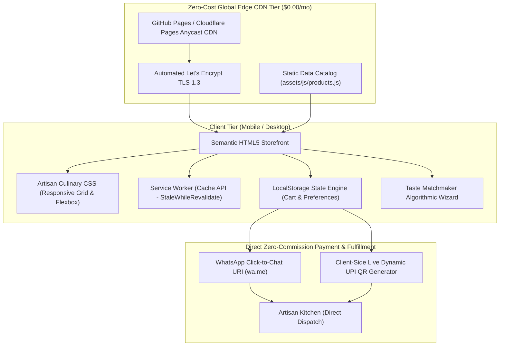
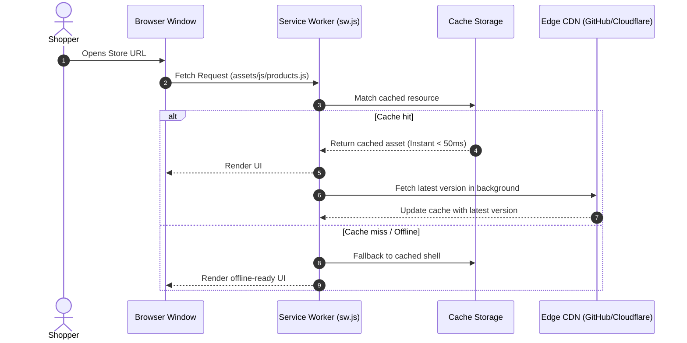

# 🏛️ System Architecture Specification

## Project: "Achaari Bliss" – Artisanal Veg & Non-Veg Pickles Platform
**Architectural Model**: Zero-Cost JAMstack PWA (Progressive Web App)  
**Monthly Operational Expenditure**: **$0.00 / month forever**  
**Version**: 2.0.0

---

## 1. High-Level Architecture Overview



---

## 2. Architectural Pillars

### 2.1 Zero-Operational Cost ($0.00/mo)
Traditional e-commerce web applications require:
- Server compute (Node.js/Django/PHP): $10–$40/mo
- Managed database (PostgreSQL/MongoDB): $15–$30/mo
- Payment gateway transaction fee: 2.0% – 3.5% + tax
- Domain SSL certificates: $10–$50/yr

**Achaari Bliss eliminates 100% of these recurring overheads**:
1. **Static Hosting**: Served directly from Edge CDN via GitHub Pages or Cloudflare Pages with zero server maintenance.
2. **Database-Free Catalog**: Catalog and product metadata reside in a typed, modular JavaScript structure loaded directly into browser memory.
3. **Zero-Gateway Transactions**: Dispatches order manifests via RFC-compliant WhatsApp URLs (`wa.me`) paired with a client-generated dynamic UPI QR code (`upi://pay?pa=...`), retaining 100% of profit margins for the producer.

---

### 2.2 Progressive Web App (PWA) & Offline Strategy



The Service Worker (`sw.js`) applies a **Stale-While-Revalidate** caching pattern:
- Static app shell files (`index.html`, `assets/css/styles.css`, `assets/js/app.js`, `assets/js/products.js`) are served immediately from cache.
- Background network requests fetch any recent updates and refresh the cache seamlessly.
- Enables shoppers to browse the entire catalog, filter spice levels, and manage their cart even in remote areas with poor or absent network connectivity.

---

### 2.3 Client-Side State Hydration

Cart and customer preferences are managed entirely in the client runtime:
1. **State Store**: Reactive in-memory state object in `app.js`.
2. **Persistence Layer**: Serialized into HTML5 `localStorage` under `achaari_bliss_cart`.
3. **Session Recovery**: Automatically rehydrates on page reload, window refresh, or tab restore.
4. **Zero-Data Leak**: No customer addresses or banking numbers are permanently stored on cloud databases, ensuring zero GDPR/DPDP/PCI-DSS regulatory liabilities.

---

### 2.4 Dynamic UPI QR Generator

Unlike traditional static QR codes that force customers to type the total amount manually, Achaari Bliss dynamically constructs an official NPCI-compliant UPI deep link:

$$\text{URI} = \text{upi://pay?pa=} \parallel \text{upiId} \parallel \text{\&pn=} \parallel \text{storeName} \parallel \text{\&am=} \parallel \text{grandTotal} \parallel \text{\&cu=INR\&tn=Order\_} \parallel \text{orderId}$$

This URI is dynamically rendered as a scannable QR code on the order confirmation screen, enabling one-tap payments via:
- Google Pay
- PhonePe
- Paytm
- BHIM / Any Banking UPI App

---

## 3. Directory Layout Standard

```
pickles_website/
├── .github/
│   ├── workflows/
│   │   ├── deploy.yml            # Automated GitHub Pages CI/CD
│   │   └── ci.yml                # Syntax & Link Validation CI
│   ├── ISSUE_TEMPLATE/
│   │   ├── bug_report.md
│   │   └── feature_request.md
│   └── PULL_REQUEST_TEMPLATE.md
├── assets/
│   ├── css/
│   │   └── styles.css            # Culinary theme styling & layout
│   └── js/
│       ├── app.js                # Core cart, quiz & WhatsApp checkout engine
│       └── products.js           # Static catalog data & store config
├── docs/
│   ├── SRS_DOCUMENT.md           # IEEE 830 Software Requirements Specification
│   ├── ARCHITECTURE.md           # System design & architecture (this file)
│   └── DEPLOYMENT_GUIDE.md       # Zero-cost hosting walkthrough
├── CHANGELOG.md                  # Release version history
├── CODE_OF_CONDUCT.md            # Contributor Covenant standard
├── CONTRIBUTING.md               # Contribution guidelines
├── index.html                    # Semantic HTML5 storefront & modals
├── LICENSE                       # MIT License
├── manifest.json                 # PWA mobile manifest
├── netlify.toml                  # Netlify deployment configuration
├── README.md                     # Project documentation & overview
├── robots.txt                    # Search engine crawler policies
├── sitemap.xml                   # SEO sitemap
├── sw.js                         # Service Worker offline engine
└── vercel.json                   # Vercel deployment configuration
```

---
*End of Architecture Specification.*
